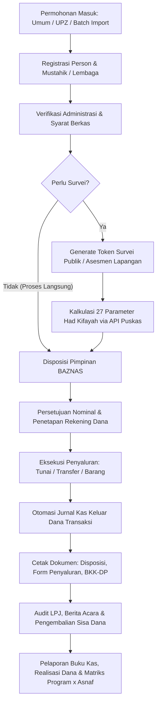
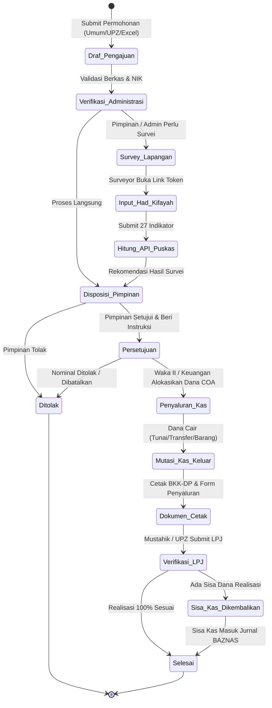
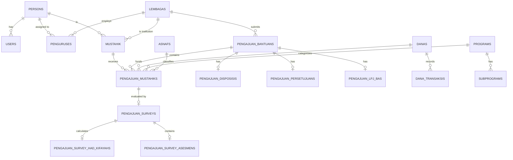
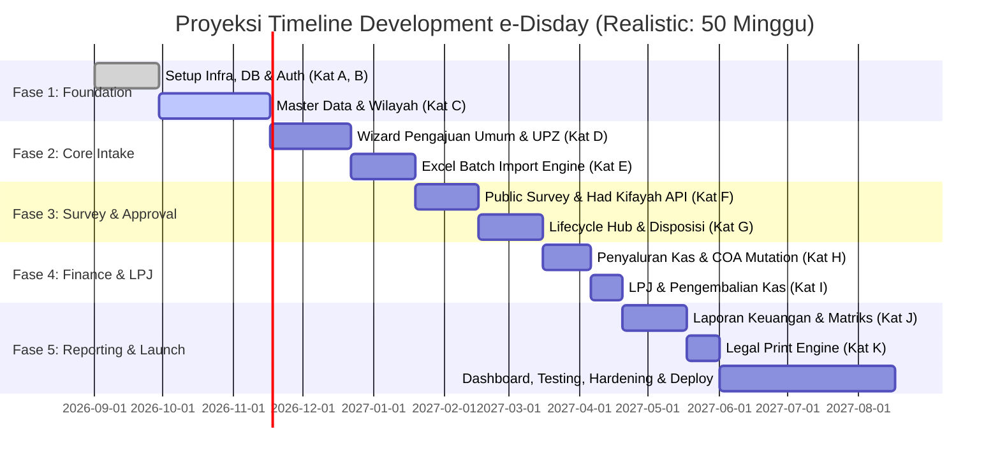

# ANALISIS SISTEM DAN ESTIMASI EFFORT DEVELOPMENT ULANG DARI NOL
## SISTEM E-DISDAY (ELEKTRONIK DISTRIBUSI & PENDAYAGUNAAN BAZNAS)
### Target Pelaksana: 1 Solo Full-Stack Developer
### Basis Kerja: 5 Jam Produktif / Hari (25 Jam / Minggu)
### Format Estimasi: Estimasi Jam Kerja (Tanpa Nilai Mata Uang)

---

## 1. WEBSITE OVERVIEW

### 1.1 Tujuan Website & Aplikasi
**e-Disday** (*Elektronik Distribusi dan Pendayagunaan*) adalah sistem otomasi tata kelola enterprise (Mini-ERP / SIMBA-aligned) yang dirancang khusus untuk mengelola seluruh siklus hidup penyaluran dana zakat, infak, sedekah, CSR, DSKL, dan dana sosial keagamaan lainnya pada BAZNAS (Badan Amil Zakat Nasional) Kabupaten/Kota. Sistem ini mengintegrasikan seluruh tahapan mulai dari penerimaan permohonan bantuan (perorangan maupun rekomendasi UPZ/lembaga), seleksi & asesmen kelayakan lapangan (termasuk kalkulasi 27 indikator Had Kifayah Puskas BAZNAS), lembar disposisi pimpinan, persetujuan nominal & alokasi rekening dana (18 COA BAZNAS), pencairan/penyaluran dana (kas keluar double-entry), hingga pelaporan realisasi (LPJ & Berita Acara) serta akuntansi buku kas.

### 1.2 Jenis Website / Aplikasi
- **Dynamic Enterprise Management Portal & Social Distribution Workflow Engine** (Web-based Internal ERP + Public Enumerator Gateway).
- Mengombinasikan portal administrasi multi-peran dengan portal asesmen publik tanpa login berbasis secure hash token untuk surveyor lapangan.

### 1.3 Target Pengguna
1. **Pemohon Bantuan / Mustahik**: Perorangan mustahik atau instansi/lembaga/UPZ pemohon.
2. **Pengurus UPZ (Unit Pengumpul Zakat)**: Operator/Ketua UPZ Masjid, Musholla, Dinas/Instansi, Sekolah, dan Perusahaan yang mengajukan rekomendasi bantuan mustahik binaannya secara individu maupun batch.
3. **Petugas / Enumerator / Surveyor Lapangan**: Petugas internal BAZNAS maupun relawan lapangan eksternal yang melakukan survei verifikasi faktual dan pengisian instrumen Had Kifayah.
4. **Staf Pendistribusian & Pendayagunaan (Admin/Operator)**: Pengelola entitas data mustahik, verifikasi berkas permohonan, pencetakan dokumen legal, dan penyusunan berkas LPJ.
5. **Pimpinan BAZNAS (Ketua & Para Wakil Ketua / Waka I s.d. IV)**: Pengambil keputusan yang memeriksa kelayakan, memberikan disposisi instruksi tindak lanjut, memvalidasi sumber dana, dan menyetujui nominal bantuan.
6. **Bagian Keuangan / Bendahara BAZNAS**: Eksekutor pencairan dana kas keluar, pencatatan transaksi masuk/keluar pada 18 pos dana COA, dan pencetakan Bukti Kas Keluar (BKK-DP).
7. **Administrator Sistem / Superuser**: Pengelola hak akses, struktur jabatan, master program, rekening dana, dan konfigurasi profil instansi.

### 1.4 Core Business Process (End-to-End Workflow)


### 1.5 Fitur Utama Sistem
1. **Multi-Role Session Switcher**: Kemampuan 1 pengguna fisik (*Person*) memegang multi-jabatan (misal: Admin BAZNAS sekaligus Ketua UPZ) dengan fitur ganti peran saat login.
2. **Multi-Channel Application Intake**: Formulir pengajuan perorangan, lembaga, maupun batch Excel multi-mustahik dengan validasi duplikasi NIK/No KK.
3. **Public Token-Based Field Survey Engine**: Akses survei lapangan ramah-mobile tanpa autentikasi login via secure URL token (32 karakter UUID/hash).
4. **Puskas BAZNAS Had Kifayah API Integration**: Kalkulasi otomatis skor kemiskinan berbasis 27 parameter pengeluaran dan pendapatan keluarga mustahik.
5. **Multi-Step Approval & Disposisi Routing**: Checklist instruksi pimpinan, routing Waka, dan persetujuan bertingkat dengan alokasi rekening dana.
6. **Automated Cash Transaction & COA Management**: Pengelolaan 18 Chart of Accounts standar BAZNAS dengan mutasi debit/kredit otomatis setiap terjadi penyaluran atau penerimaan kas.
7. **Legal Document Print Engine**: Template cetak resmi berstandar format administrasi lembaga (nomor surat Romawi, ejaan nominal bahasa Indonesia/terbilang, dan tanda tangan bertingkat).
8. **LPJ & Fund Reconciliation**: Tracking realisasi nominal bantuan dan pengembalian sisa dana ke kas BAZNAS.
9. **Financial & Distribution Matrix Reports**: Laporan realisasi dana 18 COA, matriks silang 5 Program x 8 Asnaf, dan Rekening Koran Buku Kas.

---

## 2. COMPLETE PAGE INVENTORY

Berikut adalah inventaris seluruh 22 halaman/rute aplikasi beserta fungsi, hak akses, interaktivitas, dan kompleksitasnya:

| No | Nama Halaman | URL / Path | Akses / Guard | Tipe Tampilan & Komponen | Deskripsi Fungsionalitas | Kompleksitas |
|:---|:---|:---|:---|:---|:---|:---:|
| 1 | Login Screen | `/login` | Public (Guest) | Static Form + Livewire Auth | Autentikasi email & password dengan proteksi rate-limiting. | LOW |
| 2 | Role/Jabatan Switcher | `/select-jabatan` | Auth (Multi-Role) | Dynamic Grid Cards + Session Store | Pemilihan jabatan aktif jika pengguna terdaftar di beberapa posisi/UPZ. | LOW |
| 3 | Executive Dashboard | `/` atau `/dashboard` | Auth (Role-based) | Dynamic KPI Cards + Quick Actions + Live Stats | Ringkasan statistik pengajuan, total dana disalurkan, chart per program, widget pimpinan/UPZ. | MED |
| 4 | Master Program & Subprogram | `/master/programs` | Auth (`Admin`) | 3-Column Split View + Modal CRUD | Manajemen 5 Program BAZNAS, Subprogram (Pendistribusian/Pendayagunaan), dan Asnaf sort order. | MED |
| 5 | Master Rekening Dana & Kas Masuk | `/master/danas` | Auth (`Admin`) | 2-Column Split View + Ledger Table + Modal | Master 18 Akun COA BAZNAS, pencatatan transaksi kas masuk langsung, kalkulasi saldo per akun. | HIGH |
| 6 | Manajemen Pengguna & Hak Akses | `/manajemen/pengguna` | Auth (`Admin`) | Data Table + Modal CRUD + Person Link | Pengelolaan akun user, link ke data Person, reset password, assign superuser status. | MED |
| 7 | Profil Lembaga & Pengurus BAZNAS | `/manajemen/baznas` | Auth (`Admin`) | Profile Card + JSON Config Editor + Table | Profil BAZNAS (Visi, Misi, Kontak disimpan di JSON) dan struktur pengurus internal BAZNAS. | MED |
| 8 | Manajemen UPZ (Unit Pengumpul Zakat) | `/manajemen/upz` | Auth (`Admin`, `Pimpinan`) | Filterable Table + Modal CRUD | Pengelolaan data UPZ (Masjid, Instansi, Sekolah), kontak, ketua, dan status keaktifan. | MED |
| 9 | Detail UPZ & Relasi Mustahik | `/manajemen/upz/{id}` | Auth (`Admin`, `Pimpinan`) | Multi-Tab Detail + Mustahik Table + Pengurus Modal | Profil lengkap UPZ, daftar pengurus UPZ, dan riwayat mustahik yang pernah direkomendasikan. | HIGH |
| 10 | Manajemen Lembaga Non-UPZ | `/manajemen/lembaga` | Auth (`Admin`, `Pimpinan`) | Filterable Table + Modal CRUD | Pengelolaan data yayasan, ormas, kelompok masyarakat, dan institusi umum pemohon bantuan. | MED |
| 11 | Detail Lembaga Non-UPZ | `/manajemen/lembaga/{id}` | Auth (`Admin`, `Pimpinan`) | Detail Card + Pengurus Grid + Mustahik History | Profil lembaga, struktur pengurus lembaga, dan riwayat permohonan bantuan lembaga. | HIGH |
| 12 | Manajemen Mustahik (Master Directory) | `/manajemen/mustahik` | Auth (`Admin`, `Pimpinan`, `Staf`) | Table + Search NIK/KK + Excel Import + Modal | Master data mustahik perorangan/lembaga, detail histori bantuan, dan import master mustahik. | HIGH |
| 13 | Detail Mustahik & Histori Bantuan | `/manajemen/mustahik/{id}` | Auth (`Admin`, `Pimpinan`, `Staf`) | Profile Card + Timeline Permohonan + Family Card | Rincian profil mustahik, hubungan keluarga (KK), histori survei, dan rekam jejak penyaluran dana. | HIGH |
| 14 | Manajemen Keluarga (Kartu Keluarga) | `/manajemen/keluarga` | Auth (`Admin`, `Pimpinan`, `Staf`) | Table Group by No KK + Search + Modal | Pengelompokan data person berdasarkan Nomor Kartu Keluarga dan penentuan status kepala keluarga. | MED |
| 15 | Detail Anggota Keluarga (KK) | `/manajemen/keluarga/{no_kk}` | Auth (`Admin`, `Pimpinan`, `Staf`) | Family Header + Member Table + Member Add Modal | Detail keluarga, daftar seluruh NIK anggota keluarga, dan status penerimaan bantuan per anggota. | MED |
| 16 | Daftar Pengajuan Umum | `/pengajuan/umum` | Auth (`Admin`, `Pimpinan`, `Staf`) | Stats Widget + Filter Tabs + Table + Status Badge | Indeks permohonan bantuan umum/perorangan dengan filter status, tanggal, dan program. | MED |
| 17 | Wizard Buat Pengajuan Umum | `/pengajuan/umum/create` | Auth (`Admin`, `Staf`) | Multi-Step Wizard (NIK Search -> Mustahik -> Docs) | Input permohonan umum, auto-detect NIK/Person, multi-mustahik line items, upload surat & lampiran. | HIGH |
| 18 | Daftar Pengajuan UPZ | `/pengajuan/upz` | Auth (All Auth Roles) | Stats Widget + Filter UPZ + Table + Status Badge | Indeks permohonan bantuan rekomendasi UPZ dengan indikator progres disposisi/survei. | MED |
| 19 | Buat Pengajuan UPZ | `/pengajuan/upz/create` | Auth (`Admin`, `Staf`, `UPZ`) | Multi-Step Form + UPZ Selector + Multi-Beneficiary | Input permohonan UPZ dengan verifikasi PIC/Ketua dan pendaftaran penerima manfaat. | HIGH |
| 20 | Import Batch Pengajuan UPZ (Excel) | `/pengajuan/upz/import` | Auth (`Admin`, `Staf`) | FilePond Upload + Interactive Review Table + Modals | Import data pengajuan massal via Excel, similarity check NIK, modal koreksi, upload berkas per row. | VERY HIGH |
| 21 | Hub Detail & Lifecycle Pengajuan | `/pengajuan/{id}` | Auth (All Auth Roles) | 6-Tab Interactive Workspace (Detail, Survey, Disposisi, Persetujuan, Penyaluran, LPJ) | Pusat kendali permohonan (4.600+ baris): generate survey link, input disposisi pimpinan, input persetujuan, batch disbursement modal, dan form LPJ. | VERY HIGH |
| 22 | Edit Data Pengajuan & Pemohon | `/pengajuan/{id}/edit` | Auth (`Admin`, `Staf`) | Multi-section Form | Koreksi data surat, uraian permohonan, dan penggantian identitas pemohon. | MED |
| 23 | Portal Survei Lapangan Publik | `/survey/{token}` | Public (Token-guarded) | Multi-Step Mobile Form + Geo/Photo Upload + API Had Kifayah | Form asesmen survei lapangan 5 aspek kondisi rumah, upload bukti foto, dan kalkulasi Had Kifayah. | VERY HIGH |
| 24 | Laporan Realisasi Dana (18 COA) | `/laporan/realisasi-dana` | Auth (`Admin`, `Pimpinan`, `Keuangan`) | Financial Matrix Table + Date Filter + Export Excel | Laporan mutasi kas masuk, penyaluran via UPZ vs Langsung, dan saldo akhir untuk 18 pos rekening dana. | HIGH |
| 25 | Laporan Matriks Program x Asnaf | `/laporan/program-asnaf` | Auth (`Admin`, `Pimpinan`, `Keuangan`) | 2D Cross-Tabulation Matrix + Filter Period | Matriks silang penyaluran dana antara 5 Program BAZNAS dan 8 Golongan Asnaf. | HIGH |
| 26 | Laporan Buku Kas / Jurnal Kas | `/laporan/buku-kas` | Auth (`Admin`, `Pimpinan`, `Keuangan`) | General Ledger Table + Running Balance Calculation | Buku kas harian penerimaan dan pengeluaran dana dengan kalkulasi saldo berjalan real-time. | HIGH |
| 27 | Print: Lembar Disposisi | `/pengajuan/{id}/cetak-disposisi` | Auth (All Auth Roles) | Official Paper Format (Print CSS Layout) | Cetak lembar disposisi pimpinan dengan format nomor surat, checklist instruksi, dan kolom paraf. | MED |
| 28 | Print: Form Penyaluran ZIS | `/pengajuan/{id}/cetak-form-penyaluran` | Auth (All Auth Roles) | Formal Voucher Print Layout | Dokumen pengantar penyaluran bantuan lengkap dengan tanda tangan pemohon dan petugas. | MED |
| 29 | Print: Bukti Kas Keluar (BKK-DP) | `/pengajuan/{id}/cetak-bukti-pengeluaran` | Auth (All Auth Roles) | Formal Accounting Voucher Print Layout | Bukti pengeluaran kas dengan angka terbilang rupiah Indonesia dan rincian akun COA. | MED |
| 30 | Print: Laporan Pertanggungjawaban (LPJ) | `/pengajuan/{id}/cetak-laporan-lpj` | Auth (All Auth Roles) | Formal Audit Report Print Layout | Laporan realisasi penggunaan dana dan pengembalian sisa kas yang disahkan pimpinan. | MED |

---

## 3. USER ROLES & PERMISSIONS

### 3.1 Struktur Pengguna & Multi-Jabatan
Aplikasi mengadopsi model relasi unik:
- Tabel `users` berelasi 1:1 ke tabel `persons`.
- 1 `Person` dapat memiliki banyak record pada tabel `penguruses`.
- Setiap record `Pengurus` mengaitkan Person dengan `Lembaga` (BAZNAS atau UPZ) dan `PengurusJabatan`.
- Pengguna yang memiliki lebih dari satu jabatan aktif akan diarahkan ke layar `/select-jabatan` setelah login untuk menetapkan *active role* pada sesi aktif.

### 3.2 Matriks Hak Akses Peran

| Modul & Fitur | Superuser / Admin BAZNAS | Pimpinan BAZNAS | Staf Pendistribusian | Admin Keuangan | Pengurus UPZ | Surveyor Publik |
|:---|:---:|:---:|:---:|:---:|:---:|:---:|
| **Dashboard & Statistik** | Full | Executive View | Operational View | Financial View | UPZ Only | No |
| **Master Program & Rekening Dana** | Full CRUD | View Only | View Only | View Only | No | No |
| **Manajemen Pengguna & Pengurus** | Full CRUD | View Only | No | No | No | No |
| **Manajemen UPZ & Lembaga** | Full CRUD | View Only | View Only | View Only | Own UPZ View | No |
| **Master Mustahik & Keluarga** | Full CRUD | View Only | Full CRUD | View Only | Read / Propose | No |
| **Buat Pengajuan Permohonan** | Yes | No | Yes | No | Yes (UPZ Only) | No |
| **Import Batch Pengajuan (Excel)** | Yes | No | Yes | No | No | No |
| **Generate Link Survei Lapangan** | Yes | Yes | Yes | No | No | No |
| **Isi Survei Lapangan & Had Kifayah** | Yes | No | Yes | No | No | Yes (via Token) |
| **Beri Disposisi & Instruksi** | Yes | Yes (Full) | No | No | No | No |
| **Persetujuan (Approval) Nominal** | Yes | Yes (Full) | No | No | No | No |
| **Eksekusi Penyaluran Kas** | Yes | No | Yes | Yes (Full) | No | No |
| **Verifikasi LPJ & Pengembalian Kas** | Yes | Yes | Yes | Yes | Submit LPJ | No |
| **Laporan Realisasi & Buku Kas** | Full Export | Full Export | View Only | Full Export | No | No |
| **Cetak Dokumen Legal (PDF/Print)** | Yes | Yes | Yes | Yes | Yes (Form) | No |

---

## 4. DETAILED FEATURE BREAKDOWN WITH EFFORT ESTIMATES

Di bawah ini adalah rincian estimasi jam kerja murni (*coding, logic, UI, query, API, & test*) untuk setiap fitur spesifik jika dikerjakan oleh **1 Solo Developer**:

| ID | Fitur | Deskripsi | Halaman Terkait | Peran | FE (Jam) | BE (Jam) | DB (Jam) | API (Jam) | Val (Jam) | Test (Jam) | Total Jam | Kompleksitas | Dependensi | Risiko |
|:---|:---|:---|:---|:---|:---:|:---:|:---:|:---:|:---:|:---:|:---:|:---:|:---|:---|
| **F-01** | Multi-Role Authentication & Session Switcher | Login, auth middleware, pengecekan multi-jabatan, sesi switch jabatan aktif, superuser bypass | `/login`, `/select-jabatan` | All | 8 | 12 | 4 | 2 | 3 | 5 | **34** | MED | Users, Persons, Penguruses | Sesi tersangkut saat ganti peran |
| **F-02** | Executive Analytics Dashboard | Widget ringkasan KPI, total realisasi nominal, chart distribusi 5 program, daftar disposisi pending | `/` | Admin, Pimpinan, Staf, UPZ | 12 | 14 | 6 | 0 | 2 | 4 | **38** | MED | Pengajuan, DanaTransaksi | Query agregasi lambat jika data besar |
| **F-03** | Master Program, Subprogram & Asnaf | CRUD 5 program BAZNAS, subprogram distribusi/dayaguna, sorting priority 8 golongan Asnaf | `/master/programs` | Admin | 10 | 10 | 4 | 0 | 3 | 4 | **31** | MED | Programs, Subprograms, Asnafs | Relasi data foreign key saat delete |
| **F-04** | Master 18 COA Rekening Dana & Kas Masuk | CRUD 18 pos COA BAZNAS, pencatatan kas masuk penerimaan langsung, running balance per dana | `/master/danas` | Admin, Keuangan | 14 | 18 | 6 | 0 | 4 | 6 | **48** | HIGH | Danas, DanaTransaksis | Kesalahan kalkulasi mutasi kas |
| **F-05** | Master Person, Mustahik & Similarity Check | Directory mustahik, similarity matching NIK/No KK, auto-detect duplikasi, histori bantuan | `/manajemen/mustahik` | Admin, Staf | 16 | 20 | 8 | 0 | 5 | 7 | **56** | HIGH | Persons, Mustahik, Wilayah | Duplikasi NIK tidak standar dari Excel |
| **F-06** | Manajemen Kartu Keluarga (KK) & Anggota | Grouping NIK berdasarkan nomor KK, penetapan kepala keluarga, agregasi bantuan per keluarga | `/manajemen/keluarga` | Admin, Staf | 12 | 14 | 6 | 0 | 4 | 5 | **41** | MED | Persons, Mustahik | Inkonsistensi data No KK pemohon |
| **F-07** | Master UPZ & Lembaga Management | CRUD UPZ/Lembaga, penetapan pengurus/PIC, status aktif, riwayat mustahik binaan | `/manajemen/upz`, `/manajemen/lembaga` | Admin, Pimpinan | 14 | 16 | 6 | 0 | 4 | 5 | **45** | MED | Lembagas, Penguruses | Relasi polymorphic pengurus |
| **F-08** | Wizard Pengajuan Bantuan Umum | Wizard pendaftaran pemohon umum (Individu/Lembaga), multi-beneficiary builder, upload surat | `/pengajuan/umum/create` | Admin, Staf | 20 | 24 | 8 | 0 | 8 | 8 | **68** | HIGH | PengajuanBantuan, Persons, Mustahik | Data multi-row state di Livewire |
| **F-09** | Pengajuan Rekomendasi UPZ | Form pengajuan berbasis UPZ, pemilihan mustahik terdaftar atau input baru, validasi kuota | `/pengajuan/upz/create` | Admin, Staf, UPZ | 16 | 20 | 6 | 0 | 6 | 6 | **54** | HIGH | Lembagas, PengajuanBantuan | Validasi PIC UPZ yang sah |
| **F-10** | Excel Batch Import & Validation Engine | Upload Excel, parser template, preview per-baris, similarity matcher, multi-stage DB insert | `/pengajuan/upz/import` | Admin, Staf | 24 | 32 | 10 | 0 | 12 | 12 | **90** | VERY HIGH | Maatwebsite Excel, Persons, Pengajuan | Format cell tanggal/angka tidak konsisten |
| **F-11** | Hub Manajemen Pengajuan (Detail Hub) | Layar kerja terpadu (6 tab): ringkasan, timeline, status tracker, modal action lifecycle | `/pengajuan/{id}` | All Auth | 28 | 34 | 10 | 0 | 8 | 10 | **90** | VERY HIGH | Seluruh Model Pengajuan | State management kompleks pada 1 view |
| **F-12** | Public Field Survey Engine (Token-based) | Antarmuka mobile tanpa login, asesmen 5 kriteria rumah, upload foto bukti faktual | `/survey/{token}` | Public / Surveyor | 18 | 22 | 6 | 0 | 6 | 8 | **60** | HIGH | PengajuanSurvey, Lampirans | Upload foto ukuran besar di koneksi lambat |
| **F-13** | Puskas BAZNAS Had Kifayah Integration | Integrasi HTTP REST API Puskas, kalkulasi 27 indikator, pemetaan status kelayakan | `/survey/{token}` & `/pengajuan/{id}` | System / Surveyor | 10 | 20 | 6 | 16 | 6 | 8 | **66** | VERY HIGH | Http Client, PengajuanSurveyHadKifayah | API eksternal down/timeout/payload berubah |
| **F-14** | Disposisi & Pimpinan Approval Routing | Checklist instruksi pimpinan, routing arahan Waka, catatan disposisi per mustahik | `/pengajuan/{id}` | Pimpinan, Admin | 12 | 16 | 4 | 0 | 4 | 6 | **42** | MED | PengajuanDisposisi | Multi-pimpinan conflict edit |
| **F-15** | Persetujuan & Alokasi Rekening Dana | Penetapan nominal bantuan disetujui, assign rekening dana COA BAZNAS per mustahik | `/pengajuan/{id}` | Pimpinan, Keuangan | 12 | 16 | 6 | 0 | 5 | 6 | **45** | HIGH | PengajuanPersetujuan, Danas | Validasi ketersediaan saldo pos dana |
| **F-16** | Penyaluran Dana & Cash Ledger Mutation | Eksekusi pencairan (Tunai/Transfer/Barang), batch disbursement modal, trigger kas keluar | `/pengajuan/{id}` | Keuangan, Staf | 16 | 22 | 8 | 0 | 6 | 8 | **60** | VERY HIGH | PengajuanPenyaluran, DanaTransaksi | Double-entry balance mismatch |
| **F-17** | LPJ & Audit Sisa Pengembalian Kas | Verifikasi realisasi dana, pencatatan sisa dana belum terpakai, setor balik kas BAZNAS | `/pengajuan/{id}` | Keuangan, Staf | 14 | 16 | 6 | 0 | 5 | 6 | **47** | HIGH | PengajuanLpjBa, DanaTransaksi | Selisih nominal realisasi vs persetujuan |
| **F-18** | Laporan Realisasi Dana (18 COA) | Matriks keuangan mutasi masuk, penyaluran UPZ/Langsung, saldo akhir 18 COA + Export | `/laporan/realisasi-dana` | Admin, Pimpinan, Keuangan | 14 | 18 | 8 | 0 | 3 | 6 | **49** | HIGH | Danas, DanaTransaksis, Excel Export | Query kompleks rekonsiliasi mutasi kas |
| **F-19** | Laporan Matriks Program x Asnaf | Matriks silang cross-tabulation 5 Program BAZNAS x 8 Golongan Asnaf + Filter Periode | `/laporan/program-asnaf` | Admin, Pimpinan, Keuangan | 12 | 16 | 6 | 0 | 3 | 5 | **42** | HIGH | PengajuanMustahik, Asnafs, Programs | Aggregation query lintas 4 tabel relasi |
| **F-20** | Buku Kas Harian & Rekening Koran | Jurnal penerimaan & pengeluaran kas dengan running balance otomatis per baris data | `/laporan/buku-kas` | Admin, Keuangan | 12 | 16 | 6 | 0 | 3 | 5 | **42** | HIGH | DanaTransaksis | Perhitungan saldo berjalan pagination |
| **F-21** | Official Legal Print Engine (4 Dokumen) | Layout cetak standar lembar disposisi, voucher penyaluran ZIS, BKK-DP terbilang, dan LPJ | `/pengajuan/{id}/cetak-*` | All Auth | 18 | 16 | 4 | 0 | 2 | 6 | **46** | MED | Print CSS, TerbilangHelper | Format halaman cetak terpotong di browser |
| **F-22** | Profil Lembaga & File JSON Storage | Editor profil BAZNAS (Visi, Misi, Alamat, Kontak) berbasis file storage JSON lokal | `/manajemen/baznas` | Admin | 6 | 8 | 2 | 0 | 3 | 3 | **22** | LOW | Storage Disk Local JSON | File permission error pada server hosting |

---

## 5. CRUD ANALYSIS (OBSERVED VS INFERRED)

### 5.1 Observed CRUD (Terbukti Ada di Codebase)
1. **Persons (`persons`)**: Create, Read, Update, Delete (melalui manajemen mustahik & wizard pengajuan).
2. **Users (`users`)**: Create, Read, Update, Delete (manajemen pengguna & reset password).
3. **Mustahik (`mustahik`)**: Create, Read, Update, Delete (manajemen mustahik & relasi person).
4. **Lembaga & UPZ (`lembagas`)**: Create, Read, Update, Delete, Toggle Active.
5. **Pengurus (`penguruses`)**: Create, Read, Update, Delete (SK, masa jabatan, person link).
6. **Program & Subprogram (`programs`, `subprograms`)**: Create, Read, Update, Delete, Reorder.
7. **Rekening Dana (`danas`)**: Create, Read, Update, Delete, Filter Kategori.
8. **Transaksi Dana Masuk (`dana_transaksis`)**: Create (Penerimaan Kas), Read, Detail Transaksi.
9. **Pengajuan Bantuan (`pengajuan_bantuans`)**: Create, Read, Update, Soft Update (Ditolak).
10. **Pengajuan Mustahik (`pengajuan_mustahiks`)**: Create (Line item), Read, Update, Delete.
11. **Survei Asesmen & Had Kifayah (`pengajuan_surveys`, `pengajuan_survey_asesmens`, `pengajuan_survey_had_kifayahs`)**: Create, Read, Update via Public Token Form.
12. **Disposisi Pimpinan (`pengajuan_disposisis`)**: Create, Read, Update Checklist.
13. **Persetujuan Bantuan (`pengajuan_persetujuans`)**: Create, Read, Update Nominal & Dana Ref.
14. **Penyaluran Bantuan (`pengajuan_penyalurans`)**: Create, Read, Trigger Kas Keluar.
15. **LPJ & Berita Acara (`pengajuan_lpj_bas`)**: Create, Read, Update Realisasi & Sisa.
16. **Lampiran Dokumen (`lampirans`)**: Create, Read, Delete (Polymorphic File Upload).

### 5.2 Inferred CRUD (Kebutuhan Alami yang Tersirat)
1. **Log Audit Aktivitas Pengguna**: Pencatatan riwayat perubahan status pengajuan (siapa yang menyetujui, mencairkan, atau mengubah nominal).
2. **Kategori Asnaf Management**: CRUD kustomisasi deskripsi 8 Asnaf (saat ini static seeder dengan sort order).
3. **Jurnal Pembalik / Void Kas**: Mekanisme pembatalan transaksi kas keluar jika terjadi kesalahan transfer/penyaluran tanpa merusak integritas buku kas.
4. **Backup & Restore Database**: Fitur backup berkala untuk instansi pengelola dana publik.

---

## 6. WORKFLOW & BUSINESS LOGIC ANALYSIS



### 6.1 Validasi Kritis & Aturan Bisnis (Business Rules)
1. **Validasi NIK 16 Digit**: Seluruh data pemohon dan mustahik wajib diverifikasi 16 digit angka numerik dengan pencarian kecocokan identitas person sebelumnya.
2. **Puskas BAZNAS Had Kifayah Rule**: Nilai Had Kifayah keluarga dihitung otomatis dari standar kebutuhan dasar dikurangi total pendapatan riil keluarga. Status kelayakan dikelompokkan ke dalam kategori prioritas kemiskinan (Sangat Miskin / Fakir, Miskin, Tidak Layak).
3. **Double-Entry Financial Ledger Rule**: Setiap penyaluran bantuan wajib mengaitkan `sumber_dana_id` (18 COA BAZNAS) dan secara otomatis mendebit/mengurangi kas pada tabel `dana_transaksis`.
4. **Rekonsiliasi Sisa Dana (LPJ)**: Jika `nominal_realisasi` < `nominal_disetujui`, sistem mewajibkan pengisian `nominal_sisa` dan penanda `sisa_dikembalikan` untuk membukukan kembali dana yang tidak terserap ke kas penerimaan BAZNAS.
5. **Konversi Terbilang Indonesia**: Dokumen cetak Bukti Kas Keluar (BKK-DP) mengonversi nilai numerik rupiah menjadi ejaan teks formal bahasa Indonesia (*contoh: Rp 1.500.000 -> "Satu Juta Lima Ratus Ribu Rupiah"*).

---

## 7. DATABASE ANALYSIS (OBSERVED SCHEMA)

### 7.1 Struktur Tabel Database Lengkap



| Nama Tabel | Tipe | Kolom Kunci | Relasi / Foreign Keys | Index & Soft Deletes |
|:---|:---:|:---|:---|:---|
| `persons` | OBSERVED | `id`, `nik`, `nomor_kk`, `nama`, `jenis_kelamin`, `tempat_lahir`, `tanggal_lahir`, `telepon`, `handphone`, `email`, `alamat`, `id_provinsi`, `id_kabupaten`, `id_kecamatan`, `id_kelurahan` | FK ke `wilayahs` | Unique Index `nik`, Index `nomor_kk`, `nama` |
| `users` | OBSERVED | `id`, `person_id`, `name`, `email`, `password`, `is_superuser` | FK `person_id` -> `persons.id` | Unique `email`, Index `person_id` |
| `lembagas` | OBSERVED | `id`, `nama`, `jenis`, `ketua_nama`, `ketua_nik`, `alamat`, `telepon`, `handphone`, `email`, `is_upz`, `is_active` | FK ke `wilayahs` | Index `nama`, Index `is_upz`, Index `is_active` |
| `penguruses` | OBSERVED | `id`, `jenis_pengurus`, `lembaga_id`, `person_id`, `pengurus_jabatan_id`, `no_sk`, `file_sk`, `tanggal_mulai`, `tanggal_selesai`, `is_active` | FK `lembaga_id`, `person_id`, `pengurus_jabatan_id` | Composite Index `(lembaga_id, person_id)` |
| `pengurus_jabatans` | OBSERVED | `id`, `kode`, `nama`, `tingkat`, `is_active` | Relasi ke `penguruses` | Unique `kode`, Index `nama` |
| `mustahik` | OBSERVED | `id`, `jenis_mustahik`, `person_id`, `lembaga_id`, `pekerjaan`, `nim`, `keterangan` | FK `person_id`, `lembaga_id` | Unique `person_id`, Index `lembaga_id` |
| `lembaga_mustahiks` | OBSERVED | `id`, `lembaga_id`, `mustahik_id`, `created_at`, `updated_at` | FK `lembaga_id`, `mustahik_id` | Composite Unique `(lembaga_id, mustahik_id)` |
| `pengajuan_bantuans` | OBSERVED | `id`, `nomor_pengajuan`, `jenis_permohonan`, `lembaga_id`, `pic_lembaga_id`, `mustahik_id`, `created_by`, snapshots fields, `judul_surat`, `nomor_surat`, `tanggal_surat`, `tanggal_diterima`, `ditolak_at` | FK `lembaga_id`, `pic_lembaga_id`, `mustahik_id`, `created_by` | Unique `nomor_pengajuan`, Index `jenis_permohonan`, `ditolak_at` |
| `pengajuan_mustahiks` | OBSERVED | `id`, `pengajuan_id`, `mustahik_id`, `asnaf_id`, `program_id`, `subprogram_id`, `sumber_dana_id`, `nominal`, `tanggal_penyaluran`, `metode_penyaluran` | FK `pengajuan_id`, `mustahik_id`, `asnaf_id`, `program_id`, `subprogram_id`, `danas` | Index `pengajuan_id`, Index `mustahik_id` |
| `pengajuan_surveys` | OBSERVED | `id`, `pengajuan_mustahik_id`, `token`, `tanggal_survey`, `surveyor`, `nohp_surveyor`, `hasil_akhir`, `catatan`, `status_pengisian` | FK `pengajuan_mustahik_id` | Unique `token`, Index `pengajuan_mustahik_id` |
| `pengajuan_survey_had_kifayahs` | OBSERVED | `id`, `pengajuan_survey_id`, 27 parameter pengeluaran/pendapatan, `status_kelayakan`, `kategori_prioritas`, `files_code`, `link_had_kifayah` | FK `pengajuan_survey_id` | Index `pengajuan_survey_id` |
| `pengajuan_survey_asesmens` | OBSERVED | `id`, `pengajuan_survey_id`, skor kondisi fisik rumah (atap, lantai, dinding, sanitasi, listrik), rekomendasi | FK `pengajuan_survey_id` | Index `pengajuan_survey_id` |
| `pengajuan_disposisis` | OBSERVED | `id`, `pengajuan_mustahik_id` / `pengajuan_id`, `pimpinan_id`, `instruksi`, `diteruskan_kepada`, `isi_disposisi` (JSON), `catatan` | FK `pengajuan_id`, `pimpinan_id` | Index `pengajuan_id`, Index `pimpinan_id` |
| `pengajuan_persetujuans` | OBSERVED | `id`, `pengajuan_id`, `tanggal_persetujuan`, `status`, `nominal_disetujui`, `referensi_dana` (JSON), `approved_by`, `catatan` | FK `pengajuan_id`, `users` | Index `pengajuan_id`, Index `status` |
| `pengajuan_penyalurans` | OBSERVED | `id`, `pengajuan_id`, `tanggal_penyaluran`, `nominal_penyaluran`, `metode_penyaluran`, `catatan`, `created_by` | FK `pengajuan_id`, `users` | Index `pengajuan_id` |
| `pengajuan_lpj_bas` | OBSERVED | `id`, `pengajuan_id`, `tanggal_lpj`, `nominal_realisasi`, `nominal_sisa`, `sisa_dikembalikan`, `file_lpj`, `file_ba`, `catatan`, `created_by` | FK `pengajuan_id`, `users` | Index `pengajuan_id` |
| `danas` | OBSERVED | `id`, `kode`, `nama`, `kategori`, `via_upz`, `urutan`, `keterangan`, `is_active` | Master COA Rekening Dana | Unique `kode`, Index `kategori`, Index `is_active` |
| `dana_transaksis` | OBSERVED | `id`, `dana_id`, `tanggal`, `jenis` ('Masuk','Keluar'), `nominal`, `uraian`, `referensi_type`, `referensi_id` | FK `dana_id`, Polymorphic `referensi` | Index `dana_id`, Index `tanggal`, Index `referensi_type` |
| `lampirans` | OBSERVED | `id`, `lampiranable_type`, `lampiranable_id`, `name`, `category`, `file_path` | Polymorphic Attachment | Index `(lampiranable_type, lampiranable_id)` |
| `wilayahs` | OBSERVED | `id`, `kode`, `nama`, `level` ('provinsi','kabupaten','kecamatan','kelurahan'), `parent_id` | Master Hirarki Wilayah | Index `kode`, Index `parent_id`, Index `level` |
| `programs`, `subprograms`, `asnafs` | OBSERVED | `id`, `kode`, `nama`, `jenis`, `sort_order`, `is_active` | Master Program & 8 Asnaf | Index `sort_order`, Unique `kode` |

---

## 8. API & EXTERNAL INTEGRATIONS

### 8.1 Evaluasi Status Integrasi
1. **Puskas BAZNAS Had Kifayah Calculator API** (`OBSERVED`):
   - Endpoint: `https://www.puskasbaznas.com/application/hadkifayah/controller/calculate/`
   - Method: `POST` (form-data / JSON)
   - Payload: 27 indikator demografi, anggota keluarga, pendapatan, pengeluaran pangan, non-pangan, tempat tinggal, transportasi, pendidikan, kesehatan, dan ibadah.
   - Response: Nilai Had Kifayah (Rp), persentase pemenuhan, status kelayakan ('Sangat Miskin' / 'Miskin' / 'Tidak Miskin'), kode file, dan link sertifikat.
2. **Excel Import & Export Engine** (`OBSERVED`):
   - Package: `PhpSpreadsheet` / `Maatwebsite Excel 3.1`
   - Fitur: Template generator multi-sheet, row-by-row streaming parser, sanitasi NIK, dan export laporan LPJ / Realisasi Dana.
3. **Local File Storage Engine** (`OBSERVED`):
   - Laravel Storage disk `public` & `local` untuk dokumen SK, foto bukti survei, file surat permohonan, dan penyimpanan profil BAZNAS `baznas_info.json`.
4. **WhatsApp Notification Engine** (`POSSIBLE / INFERRED`):
   - Hook siap-pakai untuk notifikasi link survei ke nomor handphone enumerator / mustahik.

---

## 9. ADMIN PANEL & MANAGEMENT FEATURES

Admin Panel e-Disday mencakup modul manajemen enterprise:
- **Pengaturan Organisasi BAZNAS**: Konfigurasi nama BAZNAS, alamat sekretariat, kontak email/telepon, visi, misi, dan nilai lembaga (disimpan terstruktur).
- **Struktur Pengurus & SK**: Pencatatan riwayat SK pimpinan dan amil pelaksana BAZNAS beserta masa berlaku jabatan.
- **Manajemen UPZ**: Direktori UPZ se-kabupaten dengan klasifikasi kategori (Masjid, Instansi Pemerintah, BUMN/BUMD, Sekolah/Madrasah, Perusahaan Swasta) dan direktori pengurus UPZ terkait.
- **Manajemen Lembaga Non-UPZ**: Database panti asuhan, yayasan yatim piatu, pondok pesantren, dan paguyuban pemohon bantuan.
- **Manajemen Hak Akses Akun**: Pengaturan kredensial login staf amil dan pimpinan, linking akun dengan profil Person, dan aktivasi role superuser.

---

## 10. FRONTEND DEVELOPMENT EFFORT DETAILS

Untuk membangun antarmuka web modern, responsif, dan interaktif:
1. **Design System & Styling Setup**:
   - Skema warna resmi BAZNAS (Emerald Green `#118243`, Deep Forest `#0d6835`, Gold/Amber Accent, Slate Neutrals).
   - Tipografi Tailwind CSS v4, styling badge status permohonan, alert cards, modal backdrop reusable, dan empty state ilustratif.
2. **Interactive UI Components**:
   - Livewire SPA-like navigation (`wire:navigate`), debounced dynamic search inputs, dependent cascading dropdowns untuk 4 tingkat wilayah (Provinsi -> Kabupaten -> Kecamatan -> Desa).
   - Tab switching tanpa reload halaman pada hub detail permohonan (Detail, Survey, Disposisi, Persetujuan, Penyaluran, LPJ, Lampiran).
   - Dynamic Multi-Row Beneficiary Builder (tambah, edit, dan hapus baris mustahik penerima bantuan secara reaktif).
   - Modal Konfirmasi Hapus Data dengan pesan peringatan kaskade relasi.
3. **Print Media CSS Styling**:
   - Layout khusus `@media print` untuk 4 jenis format dokumen negara (menghilangkan navbar, menyesuaikan ukuran kertas A4/F4, border tabel tegas, format tanda tangan 3 kolom).

---

## 11. BACKEND DEVELOPMENT REQUIREMENTS

Kebutuhan arsitektur backend:
1. **Clean Service Layer Architecture**:
   - `PengajuanService`: Pengendali transisi status alur permohonan secara transaksional (`DB::transaction`).
   - `HadKifayahController`: Gateway komunikasi HTTP Client ke API Puskas dengan penanganan timeout dan fallback error.
   - `DisposisiController` & `BuktiPengeluaranController`: Engine penyusun data cetak dengan converter angka Romawi dan bilangan terbilang bahasa Indonesia.
2. **Data Integrity & Consistency**:
   - Atomic database transactions untuk memastikan pembuatan pengajuan, mutasi kas buku kas, dan pengunggahan berkas berjalan secara *all-or-nothing*.
   - Snapshot fields (`mustahik_nama_snapshot`, `mustahik_nik_snapshot`, `lembaga_nama_snapshot`) untuk mengabadikan data historis pemohon saat pengajuan disahkan meskipun data master person/lembaga di kemudian hari diubah.

---

## 12. NON-FUNCTIONAL REQUIREMENTS

1. **Keamanan (Security)**:
   - Proteksi Token Survei Publik menggunakan 32-character high-entropy hash untuk mencegah *ID enumeration attack*.
   - Sanitasi input string dan sanitasi formula Excel pada import CSV/XLSX untuk mencegah *CSV Injection*.
   - Proteksi Role Middleware berbasis jabatan sesi aktif dengan validasi ulang otorisasi pada setiap action Livewire backend.
2. **Kinerja (Performance)**:
   - Eager loading relasi Eloquent (`with(['mustahik.person', 'persetujuan', 'pengajuanMustahiks.program'])`) untuk mengeliminasi masalah *N+1 Query*.
   - Pagination server-side pada seluruh tabel master dan laporan keuangan.
3. **Penyimpanan Berkas (Storage)**:
   - Validasi MIME type dan batasan ukuran berkas unggahan (maksimal 2MB s.d. 5MB) untuk menjaga kapasitas storage server.

---

## 13. DEVELOPMENT TASK BREAKDOWN (CATEGORIES A - K)

Berikut adalah pembagian tugas teknis pengembangan dari nol untuk 1 Solo Developer:

```
[A. Setup & Arsitektur] ──> [B. Auth & Multi-Role] ──> [C. Master Data & Wilayah]
                                                                  │
┌─────────────────────────────────────────────────────────────────┘
▼
[D. Intake Pengajuan] ────> [F. Survei & Had Kifayah API] ──> [G. Disposisi Pimpinan]
       │                                                              │
       ├──────── [E. Excel Batch Import Engine]                       ▼
       │                                                     [H. Penyaluran & Kas]
       ▼                                                              │
[M. UI Polish & Interactivity] <── [K. Legal Print Engine] <── [I. LPJ & Realisasi]
       │                                                              │
       ▼                                                              ▼
[L. Dashboard Analytics] ────────────────────────────────────> [J. Laporan & Buku Kas]
```

### Kategori A: Setup Project, Lingkungan, Arsitektur & Database Foundation
- **Task A.1**: Inisialisasi framework, dependensi packages, Tailwind CSS, konfigurasi storage disk, dan environment setup. (Complexity: `LOW`, Est: **12 Jam**)
- **Task A.2**: Desain seluruh skema migrasi database (21 tabel), composite unique index, foreign key cascade constraints, dan initial seeders. (Complexity: `HIGH`, Est: **28 Jam**)
- **Subtotal Kategori A**: **40 Jam**

### Kategori B: Autentikasi, Multi-Jabatan & Role Middleware Engine
- **Task B.1**: Implementasi sistem login, rate-limiting, proteksi sesi, dan logout. (Complexity: `LOW`, Est: **10 Jam**)
- **Task B.2**: Engine pemilih peran pasca-login (`/select-jabatan`), middleware verifikasi jabatan aktif, dan superuser bypass logic. (Complexity: `MED`, Est: **24 Jam**)
- **Subtotal Kategori B**: **34 Jam**

### Kategori C: Master Data & Entity Management
- **Task C.1**: Master Wilayah hirarki 4 tingkat (Provinsi, Kabupaten, Kecamatan, Kelurahan) dengan cascading AJAX selector. (Complexity: `MED`, Est: **18 Jam**)
- **Task C.2**: Master Program (5 Program BAZNAS), Subprogram (Distribusi/Pendayagunaan), dan Asnaf sorting engine. (Complexity: `MED`, Est: **22 Jam**)
- **Task C.3**: Master 18 COA Rekening Dana, modal form, dan pencatatan kas masuk penerimaan langsung. (Complexity: `HIGH`, Est: **32 Jam**)
- **Task C.4**: Direktori Master Person & Mustahik lengkap dengan similarity check NIK/No KK dan modal detail histori. (Complexity: `HIGH`, Est: **36 Jam**)
- **Task C.5**: Manajemen Keluarga (grouping by Nomor KK) dan penataan anggota keluarga. (Complexity: `MED`, Est: **20 Jam**)
- **Task C.6**: Manajemen UPZ & Lembaga Non-UPZ beserta relasi struktur pengurus/PIC. (Complexity: `MED`, Est: **26 Jam**)
- **Task C.7**: Manajemen Profil BAZNAS & Penyimpanan JSON storage. (Complexity: `LOW`, Est: **10 Jam**)
- **Subtotal Kategori C**: **164 Jam**

### Kategori D: Intake Pengajuan Bantuan Multi-Channel
- **Task D.1**: Wizard Pengajuan Umum (Multi-step: NIK verification, create person/mustahik, multi-beneficiary builder, upload surat). (Complexity: `HIGH`, Est: **48 Jam**)
- **Task D.2**: Form Pengajuan Rekomendasi UPZ (Pemilihan UPZ, verifikasi PIC, pendaftaran mustahik binaan). (Complexity: `HIGH`, Est: **36 Jam**)
- **Task D.3**: Filter, search, dan pagination indeks permohonan (Umum & UPZ). (Complexity: `MED`, Est: **20 Jam**)
- **Subtotal Kategori D**: **104 Jam**

### Kategori E: Batch Data Import Engine & Review Interactive Table
- **Task E.1**: Template generator Excel dinamis berbasis metadata tipe permohonan (`Individu` / `Lembaga`). (Complexity: `MED`, Est: **18 Jam**)
- **Task E.2**: Excel file streaming parser, row-by-row sanitasi data, validasi foreign relation. (Complexity: `HIGH`, Est: **26 Jam**)
- **Task E.3**: Interactive review table: koreksi inline, NIK similarity matching modal, person creation form modal, dan upload berkas per-row. (Complexity: `VERY HIGH`, Est: **36 Jam**)
- **Subtotal Kategori E**: **80 Jam**

### Kategori F: Public Field Survey Engine & Integrasi API Had Kifayah Puskas
- **Task F.1**: Public survey landing portal via high-entropy token URL (mobile responsive form, no-login). (Complexity: `HIGH`, Est: **30 Jam**)
- **Task F.2**: Form asesmen lapangan 5 aspek fisik rumah mustahik dan multi-photo upload handler. (Complexity: `HIGH`, Est: **24 Jam**)
- **Task F.3**: Integrasi HTTP Client REST API Puskas BAZNAS untuk kalkulasi 27 parameter Had Kifayah, pemetaan skor kelayakan, dan certificate link store. (Complexity: `VERY HIGH`, Est: **38 Jam**)
- **Subtotal Kategori F**: **92 Jam**

### Kategori G: Workflow Lifecycle Hub & Disposisi Pimpinan
- **Task G.1**: Hub detail permohonan terpadu (Tab detail, tracking timeline, status badge logic). (Complexity: `HIGH`, Est: **38 Jam**)
- **Task G.2**: Modal instruksi disposisi pimpinan, checklist arahan, routing Waka, dan pencatatan riwayat disposisi. (Complexity: `MED`, Est: **24 Jam**)
- **Task G.3**: Modal persetujuan (approval) nominal bantuan, alokasi COA rekening dana, dan penolakan permohonan. (Complexity: `HIGH`, Est: **28 Jam**)
- **Subtotal Kategori G**: **90 Jam**

### Kategori H: Penyaluran Dana & Automasi Jurnal Kas Keluar
- **Task H.1**: Modal eksekusi penyaluran dana (Single & Batch Modal) dengan metode Tunai / Transfer / Barang. (Complexity: `HIGH`, Est: **34 Jam**)
- **Task H.2**: Trigger double-entry mutasi kas keluar otomatis pada tabel `dana_transaksis` dan validasi saldo rekening dana. (Complexity: `HIGH`, Est: **28 Jam**)
- **Subtotal Kategori H**: **62 Jam**

### Kategori I: LPJ, Berita Acara & Audit Pengembalian Kas
- **Task I.1**: Formulir submission LPJ, upload berkas Berita Acara (BA), dan pencatatan nominal realisasi penggunaan dana. (Complexity: `MED`, Est: **22 Jam**)
- **Task I.2**: Engine rekonsiliasi sisa dana belum terserap dan pencatatan pengembalian kas (`sisa_dikembalikan`) ke kas BAZNAS. (Complexity: `HIGH`, Est: **24 Jam**)
- **Subtotal Kategori I**: **46 Jam**

### Kategori J: Financial Reporting, Realisasi Dana & Matriks Program x Asnaf
- **Task J.1**: Laporan Realisasi Dana 18 COA (Penerimaan, Penyaluran UPZ vs Langsung, Saldo Akhir) + Export Excel. (Complexity: `HIGH`, Est: **34 Jam**)
- **Task J.2**: Laporan Matriks Silang 2D (5 Program BAZNAS x 8 Golongan Asnaf) dengan filter periode. (Complexity: `HIGH`, Est: **28 Jam**)
- **Task J.3**: Laporan Buku Kas Harian & Rekening Koran dengan running balance calculator. (Complexity: `HIGH`, Est: **26 Jam**)
- **Subtotal Kategori J**: **88 Jam**

### Kategori K: Legal Document Print Engine (Layout Cetak Resmi)
- **Task K.1**: Template cetak Lembar Disposisi Pimpinan resmi BAZNAS. (Complexity: `MED`, Est: **12 Jam**)
- **Task K.2**: Template cetak Form Tanda Terima Penyaluran ZIS. (Complexity: `MED`, Est: **10 Jam**)
- **Task K.3**: Template cetak Bukti Kas Keluar (BKK-DP) dengan helper bilangan terbilang bahasa Indonesia. (Complexity: `MED`, Est: **14 Jam**)
- **Task K.4**: Template cetak Laporan Realisasi LPJ & Berita Acara. (Complexity: `MED`, Est: **10 Jam**)
- **Subtotal Kategori K**: **46 Jam**

### Kategori L: Dashboard Analytics & Role-Based Widgets
- **Task L.1**: Dashboard executive view (Pimpinan, Admin Keuangan, UPZ, Amil Staf). (Complexity: `MED`, Est: **24 Jam**)
- **Subtotal Kategori L**: **24 Jam**

---

## 14. EFFORT ESTIMATION IN HOURS (3 CASES BREAKDOWN)

Berikut adalah rekapitulasi estimasi effort total dalam jam yang mencakup seluruh aktivitas rekayasa perangkat lunak:

```
┌────────────────────────────────────────────────────────────────────────┐
│ TOTAL EFFORT (REALISTIC CASE: 1,250 JAM)                              │
├────────────────────────────────────────────────────────────────────────┤
│ █ Core Development / Coding: 770 Jam (61.6%)                           │
│ █ Testing & Quality Assurance: 120 Jam (9.6%)                          │
│ █ Bug Fixing & Hardening: 80 Jam (6.4%)                                │
│ █ Deployment, CI/CD & Prod Setup: 40 Jam (3.2%)                        │
│ █ Documentation (Tech & User Guide): 45 Jam (3.6%)                     │
│ █ Client Communication & Reviews: 60 Jam (4.8%)                        │
│ █ Scope/Requirement Clarification: 60 Jam (4.8%)                       │
│ █ Unforeseen Risk Buffer: 75 Jam (6.0%)                                │
└────────────────────────────────────────────────────────────────────────┘
```

| Komponen Pekerjaan | Minimum Case (Jam) | Realistic Case (Jam) | High / Pessimistic Case (Jam) |
|:---|:---:|:---:|:---:|
| **1. Core Development / Coding (Kat A - L)** | 515 | 770 | 1,050 |
| **2. Testing & Quality Assurance (Unit, Feature, E2E)** | 80 | 120 | 170 |
| **3. Bug Fixing, Code Refactoring & Hardening** | 50 | 80 | 120 |
| **4. Deployment, Web Server, SSL & CI/CD Pipeline** | 25 | 40 | 60 |
| **5. Technical & User Manual Documentation** | 30 | 45 | 65 |
| **6. Client Communication, Demos & Progress Meetings** | 40 | 60 | 90 |
| **7. Requirement Clarification & Design Adjustments** | 35 | 60 | 95 |
| **8. Unforeseen Technical Risk Buffer** | 40 | 75 | 120 |
| **TOTAL ESTIMASI EFFORT (JAM)** | **815 Jam** | **1,250 Jam** | **1,770 Jam** |

---

## 15. SOLO DEVELOPER TIMELINE & CAPACITY

> **Parameter Kerja Solo Developer**:
> - **Jam Kerja Efektif**: 5 Jam Produktif / Hari *(memperhitungkan fatigue, debugging, dan konteks switching)*.
> - **Hari Kerja Efektif**: 5 Hari Kerja / Minggu *(Senin s.d. Jumat)*.
> - **Kapasitas Mingguan**: **25 Jam Kerja Produktif / Minggu**.
> - **Kapasitas Bulanan**: **100 Jam Kerja Produktif / Bulan** *(4 minggu / bulan)*.

### 15.1 Proyeksi Durasi Proyek



| Skenario Estimasi | Total Effort (Jam) | Kecepatan Mingguan | Estimasi Durasi (Minggu) | Estimasi Durasi (Bulan) |
|:---|:---:|:---:|:---:|:---:|
| **Minimum Case (Best Scenario)** | 815 Jam | 25 Jam/Minggu | **32.6 Minggu** | **~8.1 Bulan** |
| **Realistic Case (Expected)** | 1,250 Jam | 25 Jam/Minggu | **50.0 Minggu** | **~12.5 Bulan** |
| **High Case (Pessimistic Scenario)** | 1,770 Jam | 25 Jam/Minggu | **70.8 Minggu** | **~17.7 Bulan** |

---

## 16. MVP VS PRODUCTION SCOPE (PHASED ROADMAP)

```mermaid
flowchart LR
    subgraph Fase 1: MVP [Fase 1: MVP Core]
        M1[Auth & Role] --> M2[Master Mustahik]
        M2 --> M3[Pengajuan Umum & UPZ]
        M3 --> M4[Approval Pimpinan]
        M4 --> M5[Penyaluran Kas Sederhana]
    end
    
    subgraph Fase 2: Production [Fase 2: Production Ready]
        P1[Public Survey Token] --> P2[API Had Kifayah Puskas]
        P2 --> P3[18 COA Mutasi Kas]
        P3 --> P4[LPJ & Sisa Dana]
        P4 --> P5[Cetak Dokumen Legal]
    end
    
    subgraph Fase 3: Full [Fase 3: Full Enterprise]
        F1[Excel Batch Import Engine] --> F2[Laporan Matriks 2D]
        F2 --> F3[Laporan Realisasi 18 COA]
        F3 --> F4[WhatsApp Notification Hook]
    end
    
    Fase 1 --> Fase 2 --> Fase 3
```

### 16.1 Pembagian Fitur Per Fase

| Tingkat Kebutuhan | Fitur & Modul | Effort (Realistic) | Target Rilis |
|:---|:---|:---:|:---:|
| **Must-Have (Fase 1: MVP)** | - Autentikasi & Multi-Jabatan Dasar<br>- Master Mustahik, Lembaga, UPZ, Program<br>- Pengajuan Bantuan Umum & UPZ (Single Item)<br>- Disposisi & Persetujuan Nominal<br>- Pencatatan Penyaluran Dasar | **450 Jam** | Bulan ke-4 s.d. 5 |
| **Should-Have (Fase 2: Production)** | - Portal Survei Publik berbasis Token URL<br>- Integrasi Kalkulator Had Kifayah API Puskas<br>- Manajemen 18 Rekening COA & Otomasi Mutasi Kas<br>- Modul Verifikasi LPJ & Pengembalian Sisa Kas<br>- 4 Format Cetak Dokumen Legal | **450 Jam** | Bulan ke-9 s.d. 10 |
| **Nice-to-Have (Fase 3: Full Scope)** | - Excel Batch Import Engine & Interactive Review Table<br>- Laporan Matriks Silang Program x Asnaf<br>- Laporan Realisasi 18 COA & Buku Kas Realtime<br>- Dashboard Executive KPI & Notifikasi | **350 Jam** | Bulan ke-12 s.d. 13 |

---

## 17. RISK ANALYSIS & MITIGATION STRATEGY

| No | Identifikasi Risiko Teknis | Penyebab / Trigger | Dampak pada Proyek | Estimasi Tambahan Effort | Strategi Mitigasi Solo Developer |
|:---|:---|:---|:---|:---:|:---|
| 1 | **Kegagalan / Perubahan API Puskas BAZNAS** | API pihak ketiga down, endpoint berubah, response time > 30s. | Form survei Had Kifayah tidak dapat disubmit. | **+30 Jam** | Bangun engine kalkulator lokal mandiri (*fallback calculator algorithm*) di dalam codebase jika API eksternal mengalami gangguan. |
| 2 | **Kompleksitas State Livewire pada Hub Detail** | File blade raksasa (>4.500 baris) dengan 6 tab dinamis dan banyak modal. | Rentan bug reaktivitas data dan performa browser lambat. | **+40 Jam** | Pecah komponen monolitik menjadi sub-komponen modular Livewire Volt terisolasi per tab. |
| 3 | **Format Data Excel Import Rusak dari Klien** | Format tanggal, NIK berupa text/eksponensial, atau nama program tidak match. | Batch import gagal, data corrupt di database. | **+35 Jam** | Buat validator baris cerdas dengan antarmuka review interaktif untuk mengoreksi anomali data sebelum commit ke database. |
| 4 | **Ketidaksinkronan Jurnal Kas Keluar** | Penyaluran terhapus/diedit tanpa trigger mutasi balik pada `dana_transaksis`. | Laporan saldo kas 18 COA menjadi tidak akurat. | **+25 Jam** | Terapkan DB Transaction ketat dan manfaatkan Eloquent Model Events / Database Trigger untuk mengunci relasi mutasi kas. |
| 5 | **Solo Developer Burnout / Single Point of Failure** | Beban kerja mandiri di seluruh layer (FE, BE, DevOps, QA, PM). | Keterlambatan delivery jadwal proyek. | **+50 Jam** | Terapkan disiplin kerja 5 jam produktif/hari, dokumentasi kode modular, dan pipeline automated testing Pest. |

---

## 18. UNKNOWN & QUESTIONS FOR CLIENT

Berikut adalah daftar pertanyaan klarifikasi teknis yang perlu diajukan kepada stakeholder sebelum proyek dimulai:

### 18.1 Pertanyaan Kritis (Critical)
1. **Akses & Dokumentasi Resmi API Had Kifayah Puskas**: Apakah BAZNAS pusat menyediakan API Key resmi atau whitelist IP server produksi, dan bagaimana SLA ketersediaan server mereka?
2. **Aturan Akuntansi Pembalik Kas**: Jika sebuah permohonan yang telah dicairkan dibatalkan, apakah sistem harus membuat jurnal pembalik otomatis atau menghapus mutasi kas keluar?
3. **Format Nomor Surat Resmi**: Apakah penomoran surat memiliki format baku selain `[Nomor]/E-DISDAY/[Tipe]/[Bulan Romawi]/[Tahun]`?

### 18.2 Pertanyaan Penting (Important)
4. **Maksimum Ukuran File Berkas Lampiran**: Berapa rata-rata jumlah berkas foto survei dan lampiran proposal per bulan untuk estimasi kapasitas server storage?
5. **Akses Pengurus UPZ**: Apakah pengurus UPZ diizinkan menginput pengajuan secara mandiri dari luar kantor BAZNAS, atau selalu diinputkan oleh staf BAZNAS?

### 18.3 Pertanyaan Opsional (Optional)
6. **Integrasi WhatsApp Gateway**: Apakah ada kebutuhan integrasi pengiriman notifikasi status pengajuan via WhatsApp kepada mustahik/UPZ?

---

## 19. FINAL DEVELOPMENT SUMMARY TABLE

| No | Modul / Kategori Pekerjaan | Min Hours | Realistic Hours | High Hours | Kategori Scope |
|:---:|:---|:---:|:---:|:---:|:---:|
| A | Setup Project, Infra, CI/CD & Database Schema | 28 | 40 | 56 | MUST-HAVE |
| B | Authentication, Multi-Role & Switcher Engine | 24 | 34 | 48 | MUST-HAVE |
| C | Master Data (Wilayah, Program, Dana, Mustahik, UPZ) | 115 | 164 | 225 | MUST-HAVE |
| D | Intake Pengajuan Bantuan (Umum & UPZ Wizards) | 72 | 104 | 145 | MUST-HAVE |
| E | Batch Excel Import Engine & Review System | 55 | 80 | 115 | NICE-TO-HAVE |
| F | Public Field Survey & Had Kifayah API Engine | 64 | 92 | 130 | SHOULD-HAVE |
| G | Lifecycle Hub, Disposisi & Approval System | 62 | 90 | 125 | MUST-HAVE |
| H | Penyaluran Dana & Cash Ledger Mutation | 42 | 62 | 88 | MUST-HAVE |
| I | LPJ, Berita Acara & Pengembalian Kas Audit | 32 | 46 | 65 | SHOULD-HAVE |
| J | Financial Reports (18 COA, Matriks 2D, Buku Kas) | 60 | 88 | 125 | SHOULD-HAVE |
| K | Official Legal Document Print Engine (4 Docs) | 32 | 46 | 65 | SHOULD-HAVE |
| L | Executive Dashboard & Widget Analytics | 16 | 24 | 35 | NICE-TO-HAVE |
| - | **Total Core Coding Subtotal** | **602** | **870** | **1,222** | - |
| - | Testing, QA & Bug Fixing Overhead | 80 | 140 | 200 | ALL PHASES |
| - | DevOps, CI/CD, Deployment & Docs | 45 | 70 | 105 | ALL PHASES |
| - | PM, Client Reviews & Requirement Buffer | 50 | 95 | 145 | ALL PHASES |
| - | Technical Risk Buffer | 38 | 75 | 98 | ALL PHASES |
| **===** | **GRAND TOTAL DEVELOPMENT EFFORT** | **815 Jam** | **1,250 Jam** | **1,770 Jam** | **END-TO-END** |
| **===** | **ESTIMASI WAKTU SOLO DEVELOPER (MINGGU)** | **32.6 Minggu** | **50.0 Minggu** | **70.8 Minggu** | **@ 25 Jam/Mgg** |
| **===** | **ESTIMASI WAKTU SOLO DEVELOPER (BULAN)** | **~8.1 Bulan** | **~12.5 Bulan** | **~17.7 Bulan** | **@ 100 Jam/Bln** |

---

## 20. IMPORTANT ASSUMPTIONS & COMPLIANCE RULES

1. **Aturan Larangan Mata Uang**: Dokumen estimasi ini murni menyajikan alokasi waktu kerja teknis (*man-hours*) tanpa menyebutkan nominal tarif uang sesuai instruksi.
2. **Kapasitas Solo Developer**: Estimasi didasarkan pada kapasitas realistis 1 orang pengembang full-stack profesional yang bekerja mandiri dengan ritme 5 jam kerja produktif per hari (25 jam produktif per minggu).
3. **Ketersediaan Spesifikasi**: Diasumsikan struktur database dan alur bisnis telah terdefinisi jelas berdasarkan analisis sistem e-Disday yang telah dibedah secara komprehensif pada dokumen ini.
4. **Penyimpanan Dokumen**: Seluruh isi dokumen ini disimpan secara permanen di dalam folder repositori proyek: `docs/analisis-estimasi/estimasi-development-solo-e-disday.md`.
